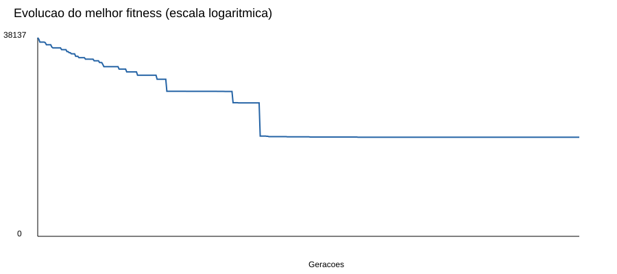

# Relatório — Trabalho 2

## Geração de Grade Horária com Algoritmo Genético

**Repositório:** https://github.com/lucaschefferh/Trabalho-2-de-IA
**Disciplina:** Fundamentos de Sistemas Inteligentes UTFPR Câmpus Santa Helena
**Docente:** Thiago Naves
**Alunos:** Lucas Scheffer Hundsdorfer (RA 2651149) e Gabriel Lima Scheffler (RA 2677180)

## 1. Objetivo

O trabalho consiste em montar a grade horária do 1º ao 4º período do curso de Ciência da Computação da UTFPR Santa Helena usando um algoritmo genético. A grade deve respeitar as seguintes condições:

- uma turma não pode ter duas disciplinas no mesmo horário;
- um professor não pode dar duas aulas ao mesmo tempo;
- uma disciplina não pode coincidir com o seu pré-requisito;
- o algoritmo deve rodar por pelo menos 500 gerações.

Além disso, o grupo incluiu restrições de salas, laboratórios, disponibilidade dos professores e distribuição das aulas ao longo do dia, descritas na seção 6.

## 2. Como executar

O programa usa apenas a biblioteca padrão do Python (3.9 ou superior) e é executado a partir da pasta `Trabalho2`:

```bash
python3 grade_genetica.py
```

Os parâmetros (população, taxas, semente, tempo máximo etc.) podem ser alterados pela linha de comando; a lista completa aparece com `python3 grade_genetica.py --help`. Os arquivos de saída são gravados na pasta `resultados`.

## 3. Organização do código

| Arquivo | Responsabilidade |
|---|---|
| `grade_genetica.py` | Leitura dos dados, avaliação das restrições, algoritmo genético e geração das saídas. |
| `dados/disciplinas.json` | Disciplinas, professores, pré-requisitos, dias, horários, salas e disponibilidades. |
| `resultados/grade.html` | Grade final por período, para abrir no navegador. |
| `resultados/grade.csv` | Encontros alocados, para planilha. |
| `resultados/historico.csv` | Melhor fitness e fitness médio de cada geração. |
| `resultados/evolucao.svg` | Gráfico da evolução do melhor fitness. |
| `resultados/resultado.json` | Configuração, avaliação, alocações e histórico completos. |

Os dados ficam separados do algoritmo, então mudar uma disciplina, professor ou sala não exige alterar o código.

## 4. Dados do curso

Foram usadas as 23 disciplinas obrigatórias da tabela COCIC-SH 2026/2 fornecida para o trabalho e uma optativa, Empreendedorismo, totalizando 24 disciplinas (Apêndice A). Professores e cargas horárias são os da tabela.

A carga semestral foi convertida em aulas semanais considerando 15 semanas e aulas de 50 minutos: 30 h equivalem a 2 aulas por semana, 45 h a 3, 60 h a 4, 90 h a 6 e 180 h a 12.

A tabela não informa pré-requisitos. Por isso o grupo os definiu a partir da sequência do curso, por exemplo AED I → AED II → AED III → Pesquisa e Ordenação.

## 5. Codificação do cromossomo

Cada disciplina presencial é dividida em encontros de no máximo duas aulas; uma disciplina de 3 aulas semanais, por exemplo, tem um encontro duplo e um simples. O Projeto Integrador é dividido em 12 aulas simples. No total são 59 encontros.

O cromossomo é um vetor de 59 inteiros, um gene por encontro, e cada gene guarda o horário em que o encontro começa. O dia tem 12 posições: seis de manhã (7h30 às 12h50) e seis à tarde (13h às 18h20). A última posição da tarde, 17h30–18h20, fica reservada para o Projeto Integrador.

Cada gene só pode receber horários compatíveis com a duração do encontro, com o turno da turma e com os dias em que o professor está disponível. Isso vale tanto para a população inicial quanto para a mutação, o que evita gastar gerações com grades que já nasceriam inválidas.

## 6. Restrições

São consideradas conflitos:

- duas disciplinas da mesma turma no mesmo horário;
- um professor em duas aulas ao mesmo tempo;
- disciplina no mesmo horário que um pré-requisito, direto ou indireto;
- dois encontros da mesma disciplina no mesmo dia;
- mais de três aulas da mesma disciplina no mesmo dia;
- mais turmas ao mesmo tempo do que salas ou laboratórios disponíveis;
- mais de quatro aulas de matemática ou seis de laboratório no mesmo dia para uma turma;
- janelas entre aulas no mesmo turno.

Os turnos foram fixados assim: 1º e 3º períodos à tarde, 2º e 4º de manhã, e a optativa do 2º período à tarde. Não há aulas regulares no sábado. Os intervalos fixos são das 10h às 10h20 e das 15h30 às 15h50.

O Projeto Integrador é on-line e não ocupa sala. As suas 12 aulas ficam em horários fixos: uma às 17h30 de segunda a sexta e sete no sábado (seis de manhã e uma às 13h).

Há seis salas de 40 lugares e seis laboratórios, três de 20 e três de 40 lugares. Como o número de alunos não foi informado, adotamos 40 por turma, então só os três laboratórios maiores podem ser usados. Foram classificadas como disciplinas de laboratório AED I, II e III, POO, Pesquisa e Ordenação, Laboratório de Banco de Dados, Circuitos Lógicos Digitais e Arquitetura de Computadores.

Também foram cadastradas restrições de disponibilidade: Thiago França Naves às segundas e terças e Agnaldo da Costa às quintas e sextas.

## 7. Função de aptidão

A aptidão de uma grade é calculada como:

    fitness = 1000 × (total de conflitos) + atraso

O objetivo é minimizar esse valor. O peso 1000 faz com que qualquer conflito pese mais que o atraso, então o algoritmo primeiro elimina os conflitos e depois melhora a distribuição. O atraso é a soma da distância de cada aula até o início do turno e favorece grades que começam mais cedo.

## 8. Operadores genéticos

- **População inicial:** 200 cromossomos sorteados dentro dos horários permitidos de cada gene.
- **Seleção:** torneio entre três indivíduos; vence o de menor fitness.
- **Cruzamento:** uniforme, com taxa de 90%; cada gene do filho vem de um dos pais.
- **Mutação:** 4% de chance por gene de sortear outro horário permitido.
- **Elitismo:** os dois melhores indivíduos passam direto para a próxima geração.
- **Melhor global:** guardado à parte, para não perder a melhor grade encontrada.

Ao final do ciclo genético é feita uma busca local sobre a melhor grade: cada encontro é testado em outros horários e pares de encontros têm os horários trocados, aceitando só as mudanças que diminuem o fitness.

A semente 42 deixa a execução reproduzível.

## 9. Condição de parada

O limite é de 1000 gerações ou 3600 segundos. O algoritmo pode parar antes se, ao mesmo tempo, já tiver rodado 500 gerações, tiver uma grade sem conflitos e passar 150 gerações sem melhorar o melhor fitness. Assim ele não para na primeira grade válida e continua tentando reduzir o atraso.

## 10. Resultados

A execução final parou na geração 500, depois de 134,8 segundos, pela condição de convergência. A melhor grade foi encontrada na geração 296.

| Métrica | Resultado |
|---|---:|
| Conflitos de turma | 0 |
| Conflitos de professor | 0 |
| Conflitos de pré-requisito | 0 |
| Encontros repetidos no mesmo dia | 0 |
| Mais de três aulas da disciplina no dia | 0 |
| Conflitos de sala/laboratório | 0 |
| Excesso de aulas por categoria no dia | 0 |
| Janelas | 0 |
| Atraso | 190 |
| Fitness | 190 |

Tabela 1 - Avaliação da melhor grade.



Figura 1 - Evolução do melhor fitness ao longo das gerações (escala logarítmica).

Como o fitness final é igual ao atraso, a grade não tem nenhum conflito. A grade completa de cada período está no Apêndice B e em `resultados/grade.html`.

## 11. Verificação

Depois da execução, a grade foi lida de volta a partir dos arquivos exportados e avaliada de novo, conferindo também se cada encontro está num horário permitido para ele. Não foi encontrado nenhum conflito.

## 12. Decisões e limitações

- **Pré-requisitos.** Como a tabela não traz os pré-requisitos, eles foram definidos pelo grupo a partir da sequência do curso.
- **Alunos por turma.** Foi adotado 40, o que deixa disponíveis só os laboratórios de 40 lugares. O valor pode ser alterado no arquivo de dados.
- **Projeto Integrador.** Por ser on-line e ter horários fixos, não segue o turno do 3º período nem a disponibilidade do professor.
- **Ótimo global.** O algoritmo genético não garante a melhor grade possível, apenas uma grade que respeita todas as restrições implementadas.

## 13. Conclusão

O algoritmo genético encontrou uma grade sem conflitos para os quatro períodos, respeitando turma, professor, pré-requisito, salas e disponibilidade docente. Restringir os genes aos horários permitidos já na criação e na mutação reduziu bastante o espaço de busca, e o peso alto dos conflitos no fitness fez o algoritmo priorizar a validade da grade antes da distribuição das aulas.

## Referências

- Tabela Matriz e Docentes COCIC-SH 2026/2, fornecida para este trabalho.
- UTFPR. Ciência da Computação – Santa Helena. https://www.utfpr.edu.br/cursos/coordenacoes/graduacao/santa-helena/sh-ciencia-da-computacao
- Material sobre algoritmos genéticos e grade horária – UFPB. https://repositorio.ufpb.br/jspui/bitstream/123456789/3824/1/JLLS01122016.pdf
- Making a Class Schedule Using a Genetic Algorithm – CodeProject. https://www.codeproject.com/Articles/23111/Making-a-Class-Schedule-Using-a-Genetic-Algorithm

## Apêndice A - Grade curricular fornecida

| Período | Código | Disciplina | CH | Docente |
|---:|---|---|---:|---|
| 1 | CC1AED1 | Algoritmos e Estrutura de Dados I | 90 | Anderson Brilhador |
| 1 | CC1ICC | Introdução à Ciência da Computação | 45 | Giuvane Conti |
| 1 | CC1MBD | Modelagem de Banco de Dados | 60 | Leiliane Pereira de Rezende |
| 1 | HU1LA | Linguagem Acadêmica | 45 | Vera Lucia Vasilevski dos Santos Araujo |
| 1 | MA1FM | Fundamentos de Matemática | 60 | Joao Augusto Navarro Cossich |
| 1 | MA1LM | Lógica Matemática | 45 | Davi Marcondes Rocha |
| 2 | CC2AED2 | Algoritmos e Estrutura de Dados II | 60 | Djonatham Caua Fritzen Christ |
| 2 | CC2CLD | Circuitos Lógicos Digitais | 60 | Gloria Patricia Lopez Sepulveda |
| 2 | CC2ER | Engenharia de Requisitos | 60 | Davi Marcondes Rocha |
| 2 | CC2POO | Programação Orientada a Objetos | 60 | Giuvane Conti |
| 2 | MA2MA | Matemática Aplicada | 60 | Evandro Alves Nakajima |
| 2 | OPHE | Empreendedorismo (optativa escolhida) | 30 | Paula Regina Zarelli |
| 3 | CC3AED3 | Algoritmos e Estrutura de Dados III | 60 | Thiago Franca Naves |
| 3 | CC3AOC | Arquitetura e Organização de Computadores | 90 | Djonatham Caua Fritzen Christ |
| 3 | CC3ES | Engenharia de Software | 60 | Wellington de Souza Ferreira |
| 3 | CC3PI1 | Projeto Integrador I: Computação e Educação | 180 | Agnaldo da Costa + 1 professor não identificado |
| 3 | MA3AL | Álgebra Linear | 45 | Evandro Alves Nakajima |
| 3 | MA3CA | Cálculo Aplicado | 60 | Vanderlea de Lima Inaba |
| 4 | CC4IHC | Interação Humano Computador | 60 | Wellington de Souza Ferreira |
| 4 | CC4LBD | Laboratório de Banco de Dados | 60 | Leiliane Pereira de Rezende |
| 4 | CC4PO | Pesquisa e Ordenação | 60 | Gloria Patricia Lopez Sepulveda |
| 4 | CC4RC | Redes de Computadores | 60 | Agnaldo da Costa |
| 4 | CC4SO | Sistemas Operacionais | 60 | Agnaldo da Costa |
| 4 | MA4PE | Probabilidade e Estatística | 60 | Joao Augusto Navarro Cossich |

## Apêndice B - Grade gerada pelo algoritmo

### 1º período

| Disciplina | Dia | Início | Duração | Professor |
|---|---|---|---:|---|
| CC1AED1 | Segunda | 13:00 | 2 aulas | Anderson Brilhador |
| MA1FM | Segunda | 14:40 | 2 aulas | Joao Augusto Navarro Cossich |
| MA1LM | Segunda | 16:40 | 1 aula | Davi Marcondes Rocha |
| HU1LA | Terça | 13:00 | 1 aula | Vera Lucia Vasilevski dos Santos Araujo |
| CC1MBD | Terça | 13:50 | 2 aulas | Leiliane Pereira de Rezende |
| MA1FM | Terça | 15:50 | 2 aulas | Joao Augusto Navarro Cossich |
| CC1MBD | Quarta | 13:00 | 2 aulas | Leiliane Pereira de Rezende |
| CC1ICC | Quarta | 14:40 | 1 aula | Giuvane Conti |
| HU1LA | Quarta | 15:50 | 2 aulas | Vera Lucia Vasilevski dos Santos Araujo |
| CC1AED1 | Quinta | 13:00 | 2 aulas | Anderson Brilhador |
| MA1LM | Quinta | 14:40 | 2 aulas | Davi Marcondes Rocha |
| CC1AED1 | Sexta | 13:00 | 2 aulas | Anderson Brilhador |
| CC1ICC | Sexta | 14:40 | 2 aulas | Giuvane Conti |

### 2º período

| Disciplina | Dia | Início | Duração | Professor |
|---|---|---|---:|---|
| MA2MA | Segunda | 07:30 | 2 aulas | Evandro Alves Nakajima |
| CC2AED2 | Segunda | 09:10 | 2 aulas | Djonatham Caua Fritzen Christ |
| CC2POO | Terça | 08:20 | 2 aulas | Giuvane Conti |
| CC2ER | Terça | 10:20 | 2 aulas | Davi Marcondes Rocha |
| CC2CLD | Quarta | 08:20 | 2 aulas | Gloria Patricia Lopez Sepulveda |
| CC2AED2 | Quarta | 10:20 | 2 aulas | Djonatham Caua Fritzen Christ |
| CC2CLD | Quinta | 07:30 | 2 aulas | Gloria Patricia Lopez Sepulveda |
| CC2POO | Quinta | 09:10 | 2 aulas | Giuvane Conti |
| CC2ER | Sexta | 08:20 | 2 aulas | Davi Marcondes Rocha |
| MA2MA | Sexta | 10:20 | 2 aulas | Evandro Alves Nakajima |
| OPHE | Sexta | 13:00 | 2 aulas | Paula Regina Zarelli |

### 3º período

| Disciplina | Dia | Início | Duração | Professor |
|---|---|---|---:|---|
| CC3ES | Segunda | 13:00 | 2 aulas | Wellington de Souza Ferreira |
| CC3AED3 | Segunda | 14:40 | 2 aulas | Thiago Franca Naves |
| CC3PI1 (on-line) | Segunda | 17:30 | 1 aula | Agnaldo da Costa |
| MA3CA | Terça | 13:00 | 2 aulas | Vanderlea de Lima Inaba |
| CC3AED3 | Terça | 14:40 | 2 aulas | Thiago Franca Naves |
| CC3PI1 (on-line) | Terça | 17:30 | 1 aula | Agnaldo da Costa |
| CC3AOC | Quarta | 13:00 | 2 aulas | Djonatham Caua Fritzen Christ |
| MA3AL | Quarta | 14:40 | 2 aulas | Evandro Alves Nakajima |
| CC3PI1 (on-line) | Quarta | 17:30 | 1 aula | Agnaldo da Costa |
| CC3AOC | Quinta | 13:00 | 2 aulas | Djonatham Caua Fritzen Christ |
| CC3ES | Quinta | 14:40 | 2 aulas | Wellington de Souza Ferreira |
| MA3AL | Quinta | 16:40 | 1 aula | Evandro Alves Nakajima |
| CC3PI1 (on-line) | Quinta | 17:30 | 1 aula | Agnaldo da Costa |
| CC3AOC | Sexta | 13:00 | 2 aulas | Djonatham Caua Fritzen Christ |
| MA3CA | Sexta | 14:40 | 2 aulas | Vanderlea de Lima Inaba |
| CC3PI1 (on-line) | Sexta | 17:30 | 1 aula | Agnaldo da Costa |
| CC3PI1 (on-line) | Sábado | 07:30 a 12:50 | 6 aulas | Agnaldo da Costa |
| CC3PI1 (on-line) | Sábado | 13:00 | 1 aula | Agnaldo da Costa |

### 4º período

| Disciplina | Dia | Início | Duração | Professor |
|---|---|---|---:|---|
| CC4PO | Segunda | 07:30 | 2 aulas | Gloria Patricia Lopez Sepulveda |
| CC4LBD | Segunda | 09:10 | 2 aulas | Leiliane Pereira de Rezende |
| CC4IHC | Terça | 07:30 | 2 aulas | Wellington de Souza Ferreira |
| MA4PE | Terça | 09:10 | 2 aulas | Joao Augusto Navarro Cossich |
| CC4PO | Terça | 11:10 | 2 aulas | Gloria Patricia Lopez Sepulveda |
| MA4PE | Quarta | 08:20 | 2 aulas | Joao Augusto Navarro Cossich |
| CC4IHC | Quarta | 10:20 | 2 aulas | Wellington de Souza Ferreira |
| CC4RC | Quinta | 08:20 | 2 aulas | Agnaldo da Costa |
| CC4SO | Quinta | 10:20 | 2 aulas | Agnaldo da Costa |
| CC4LBD | Sexta | 07:30 | 2 aulas | Leiliane Pereira de Rezende |
| CC4SO | Sexta | 09:10 | 2 aulas | Agnaldo da Costa |
| CC4RC | Sexta | 11:10 | 2 aulas | Agnaldo da Costa |
